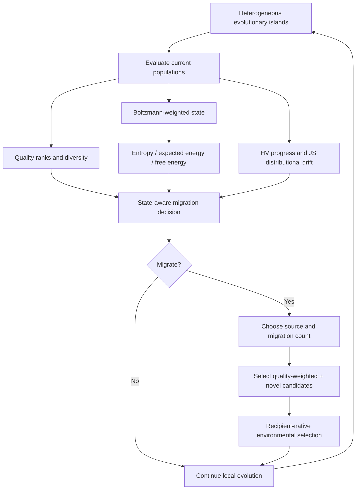

<div align="center">

# TherMOO

### Thermodynamic Population-Aware Migration for Multi-Objective Optimization

**When should evolutionary islands exchange solutions, which island should supply them, and which candidates should move?**

TherMOO is an experimental framework for studying **state-aware migration in heterogeneous multi-objective evolutionary algorithms**. It represents each population through optimization quality, a Boltzmann-weighted state, entropy, free energy, distributional drift, and decision-space diversity, then uses these signals to coordinate migration.

[](LICENSE)


**[Method](#the-idea)** · **[Experimental design](#experimental-design)** · **[Figures v5](#figures-and-statistics-v5)** · **[Run the code](#getting-started)** · **[Reproducibility](#reproducibility-and-interpretation)**

</div>

---

## Overview

Multi-objective evolutionary algorithms search for sets of trade-off solutions rather than one optimum. Island models can distribute this search across distinct populations, but migration is often driven by a **fixed exchange schedule** and **fixed selection rules**, regardless of whether an island is improving, stagnating, converging prematurely, or exploring a complementary part of the search space.

**TherMOO investigates migration as a population-state decision.** Instead of treating every island and exchange opportunity alike, its `FULL` policy uses observable properties of each island to decide:

1. **When to migrate** — evidence from optimization progress, population drift, and diversity.
2. **Where to migrate from** — source-island quality and complementarity.
3. **How many solutions to send** — an adaptive, bounded migration count.
4. **Which solutions to send** — a mixture of quality-weighted and novel candidates.
5. **How to incorporate them** — the recipient optimizer's environmental-selection mechanism.

The method is tested within a controlled harness that also supports conventional migration policies, independent evolutionary optimizers, component ablations, alternative island compositions, and larger objective or decision spaces.

> **Scope:** The implemented `FULL` controller is **heuristic and explicitly specified**, not a trained neural network. “Entropy,” “energy,” “temperature,” and “free energy” are mathematical descriptors of the search population; they are not claims that the optimizer follows physical thermodynamics. The published experiment plan does not by itself establish that every trial completed or that TherMOO outperforms every baseline. Use the recorded coverage and statistical reports for such statements.

## The idea

Each island evolves a population using an established multi-objective optimizer. At coordination points, TherMOO computes a compact state description and evaluates whether transferring individuals is appropriate.



### Population-state representation

For individual quality score $q_i$, the implementation uses a rank-prioritized score and temperature-dependent Boltzmann weights:

$$
q_i=-\operatorname{rank}_i+0.49\,s_i,\qquad
p_i=\frac{\exp(q_i/T)}{\sum_j\exp(q_j/T)}.
$$

The default $s_i$ is normalized crowding information; sensitivity experiments also consider hypervolume contribution and genotype novelty. The resulting state descriptors include

$$
H=-\sum_i p_i\log p_i,\qquad
\overline E=\sum_i p_i(-q_i),\qquad
F=\overline E-TH.
$$

Here $H$ quantifies the concentration of **quality weights**, not geometric population spread. Decision-space diversity is measured separately (using Hamming distance for binary ZDT5). Distributional change is assessed through Jensen–Shannon divergence between objective-space histograms defined in a shared fixed coordinate frame. These signals are combined with hypervolume progress and other state features by the migration controller.

**Implementation reference:** [`thermoo/control.py`](thermoo/control.py) defines the state variables, thresholds, coefficients, migration gate, source scoring, and migrant-selection rules. [`thermoo/engine.py`](thermoo/engine.py) orchestrates the evaluations and exchanges.

## Implemented optimization methods

The primary study compares ten method configurations under a shared evaluation budget.

| Category | Method | Role |
|:--|:--|:--|
| Standalone | **NSGA-II** | Nondominated sorting and crowding-based survival |
| Standalone | **MOEA/D** | Decomposition-based optimization |
| Standalone | **GDE3** | Multi-objective differential evolution |
| Standalone | **SMS-EMOA** | Hypervolume-contribution environmental selection |
| Islands | **NO_MIG** | Independent islands, no exchange |
| Islands | **RANDOM** | Periodic random ring migration |
| Islands | **ELITE** | Periodic elite migration |
| Islands | **HV_GATE** | Migration triggered by insufficient HV progress |
| Islands | **CROWDING** | Rank/crowding-based migration and replacement |
| Islands | **FULL** | Thermodynamic-descriptor-aware adaptive migration |

The default heterogeneous system places **NSGA-II, MOEA/D, GDE3, and SMS-EMOA** on four islands. The five-objective extension also includes **NSGA-III** and **RVEA** as standalone comparators.

**Binary exception:** ZDT5 uses an 80-bit representation; its nominal GDE3 slot is implemented with **SPEA2**. This is explicitly tracked in the experimental exports and handled separately in omnibus analyses.

## Experimental design

The design covers **61 benchmark functions** from six families: **ZDT (6), DTLZ (7), WFG (9), LZ09 (9), UF (10), and ZCAT (20)**. These include variations in Pareto-front geometry, variable interaction, multimodality, difficulty, and objective count.

### The 33,240-trial protocol

| Study | Experimental configuration | Planned trials |
|:--|:--|--:|
| **Main benchmark** | 61 problems × 10 methods × 30 seeds | **18,300** |
| **Component ablation** | 10 problems × 7 ablations × 30 seeds | **2,100** |
| **Sensitivity analysis** | 10 problems × 8 one-factor variations × 30 seeds | **2,400** |
| **Homogeneous islands** | 10 problems × 4 optimizer compositions × 3 policies × 30 seeds | **3,600** |
| **Number of islands** | 10 problems × 2 additional island counts × 3 policies × 30 seeds | **1,800** |
| **Five objectives** | 6 problems × 12 methods × 30 seeds | **2,160** |
| **Higher dimensions** | 6 problems × 2 added dimensions × 8 methods × 30 seeds | **2,880** |
| **Total** | Unique planned problem–configuration–seed trials | **33,240** |

Control runs reused across studies retain their original identities and **are not counted twice**.

#### What is varied?

- **Ablations:** conventional state; no entropy; no free energy; no Jensen–Shannon divergence; fixed migration count; random source; Boltzmann-only migrant selection.
- **Sensitivity:** migration interval **5/20**, migration fraction **0.05/0.20**, temperature multiplier **0.5/2.0**, and quality scoring via rank–HV or rank–novelty.
- **Composition:** homogeneous NSGA-II, MOEA/D, GDE3, or SMS-EMOA islands versus heterogeneous islands.
- **Island count:** **4, 8, and 16** islands, keeping the **total population fixed at 400**.
- **Many-objective tests:** five objectives on DTLZ2, DTLZ7, WFG4, WFG9, ZCAT14, and ZCAT20.
- **Decision-space scalability:** **D = 50** and **D = 100** on ZDT4, DTLZ2, DTLZ7, WFG9, UF1, and ZCAT20.

The representative ten-function panel is **ZDT1, ZDT3, DTLZ2, DTLZ7, WFG1, WFG9, LZ09_F1, UF8, ZCAT14, and ZCAT20**.

### Common optimization settings

| Parameter | Default |
|:--|:--|
| Evaluation budget | **100,000 objective-vector evaluations per trial** |
| Independent replications | **30 seeds (0–29)** |
| Global population | **400** |
| Islands | **4 × 100** individuals by default |
| Standalone population | **400** |
| Nondominated output archive | **400** solutions maximum |
| Migration interval | **10 local generations** |
| Maximum migrant fraction | **0.10** |
| Temperature multiplier | **1.0** |
| HV progress threshold | **1e-4** |
| JS drift threshold | **0.02** |
| Crossover | SBX, probability **0.9**, distribution index **20** |
| Mutation | Polynomial, per-variable probability **1/D**, index **20** |

Objective vectors transferred between islands retain their cached evaluations; they are **not re-evaluated merely because they migrate**. All optimizers are compared at a fixed total function-evaluation budget.

## Figures and statistics (v5)

The repository includes the **v5 scientific reporting layer** and experimental scripts/logs. The figure and statistical outputs are intentionally separated from the underlying optimizer implementation.

| Resource | Contents | Browse |
|:--|:--|:--|
| **FIGURES/v5** | Rendered scientific figures, including raster/vector output and associated captions or indexes where available | **[Open figures →](FIGURES/v5/)** |
| **STATS/v5** | Per-run summaries, paired comparisons, inferential statistics, ranks, coverage information, and reporting metadata | **[Open statistics →](STATS/v5/)** |
| **thermoo/** | Optimization engine, controller, benchmarks, and analysis implementation | **[Inspect source →](thermoo/)** |
| **scripts/** | Setup, rendering, snapshots, and helper scripts | **[Inspect scripts →](scripts/)** |
| **logs/** | Captured execution logs and diagnostic messages | **[Inspect logs →](logs/)** |

The visualization pipeline is designed for **interpretable cross-problem synthesis**, rather than large collections of isolated trajectories. Its reporting scope includes method rankings, family-level behavior, paired contrasts, ablations, one-factor sensitivity, island composition and count, dimensional scaling, five-objective tests, quality/runtime trade-offs, and migration overhead. Which panels are populated depends on the coverage of the input snapshot.

**Reading the plots:** HV is better when **higher**; IGD+ is better when **lower**. Results from different objective counts or benchmark functions should not be compared by simply pooling unnormalized raw scores. Figure captions and corresponding exported tables define the exact aggregation used in each panel.

> **Data-scope note:** This GitHub export prioritizes code, v5 figures/statistics, and lightweight logs. Large raw population arrays, downloaded benchmark datasets/sources, cached environments, or older reporting versions may be absent. Check the manifest and coverage files before assuming that every raw run artifact is present in the repository.

## Evaluation and statistical methodology

**Primary solution-quality indicators** are normalized **hypervolume (HV)** and **inverted generational distance plus (IGD+)**. Reference fronts are created independently of the compared solver outputs. Metrics use common reference-set ideal/nadir normalization; the HV reference point is $(1.1,\ldots,1.1)$, and reported HV is divided by $1.1^M$.

**Additional diagnostics** include migrants sent and accepted, logical genotype/objective-array payload, convergence observations at actual evaluation counts, controller overhead, migrant-integration time, and total observed runtime.

**Statistical protocol:**

- Pair methods using the **same problem and seed**, verifying the matched initial-population identity.
- Report within-condition summaries rather than treating different seeds or dimensions as unrelated benchmark functions.
- Use **paired sign-flip randomization tests** (50,000 resamples) for primary matched differences.
- Derive **95% bootstrap intervals** for paired mean differences (4,000 resamples).
- Apply **Holm correction** to the relevant family of comparisons, including HV and IGD+.
- Use **Friedman and post-hoc rank comparisons** only on eligible complete-case problem panels; retain family-balanced summaries.
- Require all **30 matched completed seeds** for confirmatory pairwise inference. Partial snapshots are descriptive.

The binary ZDT5 implementation is analyzed separately where the SPEA2-for-GDE3 substitution would compromise the interpretation of a cross-problem method ranking.

## Getting started

### Requirements

TherMOO is Python-based and uses NumPy/SciPy, multi-objective optimization libraries, and benchmark implementations. The original setup expects local benchmark source trees (including pymoo, jMetalPy/LZ09, and ZCAT) and uses a project-local `vendor_deps` directory for selected helper packages.

**A lightweight GitHub export is not necessarily a completely self-contained fresh install.** Ensure that required third-party benchmark sources and compatible dependencies have been restored, and review their licenses before reproducing a full campaign. The existing install script avoids replacing an already working NumPy/SciPy stack.

```bash
# Clone the repository
git clone https://github.com/cataug/TherMOO.git
cd TherMOO

# Select a Python environment with NumPy and SciPy.
# Restore the required benchmark source trees before preparation.
python3 scripts/install_thermoo.py

# Build references and verify implementations
python3 -m thermoo prepare
python3 -m thermoo verify

# Inspect the exact experimental matrix
python3 -m thermoo plan

# Run a small diagnostic campaign
python3 -m thermoo smoke --workers 4
```

### Targeted experiments

```bash
# Main block, two problems, two seeds
python3 -m thermoo run --blocks main --problems ZDT1 ZDT5 --seeds 0 1 --workers 2

# Main comparison + ablations
python3 -m thermoo run --blocks main ablation --workers 4

# Five-objective subset
python3 -m thermoo run --blocks many --max-jobs 12 --workers 2

# Generate standard experimental reports
python3 -m thermoo analyze --output full --plots
```

For a long foreground run, the repository also provides [`run_all.sh`](run_all.sh). **Use `pilot` and `smoke` before launching the complete experiment matrix.** Completed trials are skipped when rerun under a matching experiment fingerprint; interrupted runs restart at **trial level**, not at a saved generation.

## Repository map

```text
TherMOO/
├── thermoo/
│   ├── plan.py          # benchmark families and exact trial matrix
│   ├── problems.py      # problem adapters and reference sets
│   ├── algorithms.py    # evolutionary algorithm integration
│   ├── control.py       # population-state descriptors and migration policy
│   ├── engine.py        # optimization trial execution and logging
│   ├── analysis.py      # metrics, aggregates, and statistical analysis
│   ├── cli.py           # prepare / verify / plan / run / analyze commands
│   ├── runtime.py       # environment and source fingerprints
│   └── verify.py        # implementation checks
├── scripts/             # installers, snapshot and reporting utilities
├── tests/               # statistical tests
├── configs/             # planned jobs and reference metadata
├── logs/                # lightweight execution logs
├── FIGURES/v5/          # selected v5 figures
├── STATS/v5/            # selected v5 statistics and provenance
├── run_all.sh           # foreground campaign runner
└── LICENSE
```

This tree highlights the research components; the actual checkout may also contain additional scripts, vendor sources, reports, and lightweight experimental records.

## Reproducibility and interpretation

Several implementation choices are important when interpreting comparisons:

- **Fixed FE budgets, not fixed wall time.** One evaluation means one evaluated objective vector, regardless of objective count.
- **Matched initialization.** Methods share their initial genotypes where problem configuration and population size match; solver and migration RNG streams are separate.
- **Sequential island scheduling.** Independent trials may run concurrently, but islands within a trial are coordinated sequentially. **Island-count experiments do not demonstrate physical parallel speedup.**
- **Logical payload, not network traffic.** Transferred bytes count numerical arrays, not actual MPI packets, network latency, or distributed communication overhead.
- **Controller identity.** `FULL` denotes the implemented explicit heuristic. A future learned migration controller would require a separate, leakage-controlled training/evaluation protocol.
- **Immutable experiment identity.** Code versions, dependency versions, native benchmark hashes, and reference data are included in experiment fingerprints to avoid silently merging incompatible campaigns.
- **Coverage before claims.** Results, statistical significance, and complete-run claims should be taken from the relevant versioned statistics and manifests—not inferred from the number of planned jobs.

## Limitations and research directions

The framework makes it possible to investigate several questions without assuming that any one migration policy is universally preferable:

1. **When does state-aware migration help?** Examine effects by front geometry, multimodality, dimension, and objective count rather than relying only on a global mean rank.
2. **Which state descriptors matter?** Separate the contributions of entropy, free energy, distributional drift, and novelty through controlled ablations.
3. **How does heterogeneity interact with migration?** Compare mixed-optimizer and homogeneous islands under matched budgets.
4. **What is the benefit relative to cost?** Relate solution-quality changes to measured coordination time and logical transfer volume.
5. **How robust are decisions?** Evaluate different island counts, migration intervals, temperatures, source-selection rules, and unseen benchmark families.
6. **Can policies be learned safely?** Study genuinely trained controllers only with dedicated training benchmarks and strictly held-out evaluation problems.
7. **Can results transfer to applied optimization?** Extend the harness to constrained, expensive, dynamic, and real-world engineering objectives while preserving reproducible budgets.

These are **research directions**, not claims of already validated capabilities.

## Scientific use and citation

TherMOO is a research implementation intended for transparent, reproducible investigations of population-aware migration in multi-objective evolutionary optimization. If it supports a publication, please cite the corresponding article once available and reference the **specific repository commit** and **statistics snapshot** used in the study.

```text
Repository: https://github.com/cataug/TherMOO
Code version: <commit SHA>
Statistics snapshot: STATS/v5 (or the exact version analyzed)
Evaluation protocol: 33,240 planned trials; see thermoo/plan.py
```

### Third-party implementations

TherMOO incorporates or interfaces with external implementations and benchmark generators, each governed by its own license and attribution requirements:

- [pymoo](https://github.com/anyoptimization/pymoo)
- [jMetalPy](https://github.com/jMetal/jMetalPy)
- [ZCAT](https://github.com/evo-mx/ZCAT)
- [PaGMO / CEC2009 UF problems](https://github.com/esa/pagmo2)

See the repository's `LICENSE`, vendor notices, and source files for the complete licensing context. Original TherMOO code is distributed under **GPL-3.0-or-later**.

---

<div align="center">

**TherMOO — evolution is local; migration is a decision.**

[Browse the code](https://github.com/cataug/TherMOO) · [Figures v5](FIGURES/v5/) · [Statistics v5](STATS/v5/)

</div>
